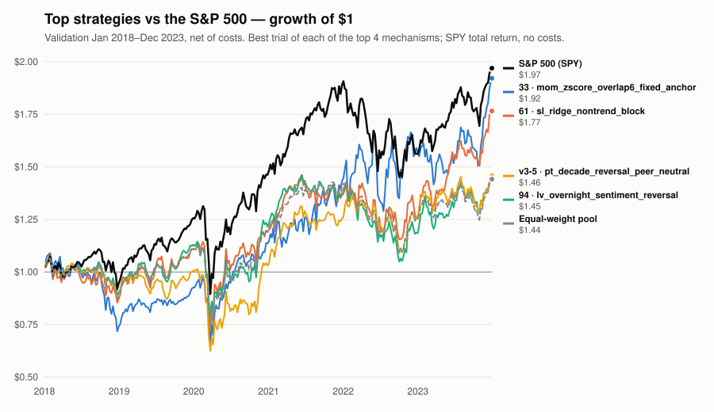

# Weekly Report — 2026-W43 (Oct 18–19)

**TL;DR.** One nightly session ran since last week's report (the night of Oct 17/18): a single
statistical-learning trial swapped the lab's linear combiner for a tree-based one and failed
validation, leaving the champion seat empty for a fourth straight week at 118 lifetime trials.
The session's real yield is methodological — it found and filed (without touching) a bias in the
engine's random-selection null that undercounts a candidate's bar by up to +0.018 of Sharpe, and
it closed the entire risk-weighting axis (minimum variance, risk parity) as structurally
unscorable under this protocol's objective. Separately, a reporting-infrastructure branch that
stalled Thursday's session at setup was merged this morning (PR #10), so this is the **first
week `scripts/weekly_board.py` exists on `main`** and the leaderboard below is generated by it
rather than assembled by hand.

## Champion & trend

Still no seat under v2/v3, unchanged from the prior four weeks. `strategies/champion_card.json`
remains the stale v1 card for `pt_mom_evar_arbrisk` (promoted #98): validation Sharpe 1.269,
holdout Sharpe 1.411. That card carries no `protocol_version` marker and holds no seat under
v3's cost model and skill-vs-pool metric — the full v1 ladder scores negative skill once
re-scored under realistic v3 execution. No promotions, retirements, or holdout reads this week.

## Trial activity this week

**1 trial, scout track, `GATE_FAIL`** — the only experiment the session ran before stopping
itself on discovering a measurement-instrument bug (see below), rather than running further
trials under a gate known to be biased:

| # | candidate | family | val Sharpe | skill vs pool | null %ile |
|---|---|---|---|---|---|
| 8 | `sl_gbm_seven_nonlinear` | statistical-learning | +0.28 | −0.06 | 42% |

Equal-weight pool: validation Sharpe +0.34, train +0.52. `scripts/rank_trials.py` still places
all eight v3 trials in tier 1 — the data cannot yet separate any of them from the best —
with `pt_decade_reversal_peer_neutral` (#5) still nominally on top (skill −0.01, P(best) 30%).
Tonight's trial ranks fifth on skill and is mechanism-correlated with the family's liquidity
lead, so `distinct_mechanisms` holds at **5**.

**Budget / family coverage.** One trial, in `statistical-learning` — the "at least one in a
family with no recorded trial" rule, now satisfied for that family. No family hit its cap.
`lead-lag-spillover` remains the **only** family with zero v3 trials, and this is now the
**second** session to argue it is structurally unreachable under this gate rather than merely
untried — a decision the lab has flagged twice for the human owner without a ruling yet.

**Deflated-Sharpe bar.** Lifetime trial count is now **118** (104 v1, 6 v2, 8 v3). No v3 trial
has beaten validation Sharpe against an empty champion seat, so the DSR ≥ 0.95 gate still has
nothing to engage against.

## Top 3 learnings

1. **The engine's random-selection null is measurably biased against low-turnover candidates,
   and the bug was filed, not fixed.** `benchmarks.random_null_v3` scores its replicas without
   re-applying the eligibility mask the candidate's own book is held to, so a replica keeps
   holding a name after it leaves the index. Measured directly (20 draws, reproducing the
   engine's own null median to three decimals): replicas carry 4.8% of their weight on
   delisted-but-still-priced names, inflating the null median and charging a boundary-respecting
   candidate about **+0.018 of Sharpe it cannot earn** — worse the longer a book holds a name
   (≈0 for monthly turnover, up to +0.017 for a full membership-spell hold). No recorded
   `GATE_FAIL` is in doubt (the bias only makes the gate harder), but it does corrupt inference:
   a research idea's entire measured +0.020 selection margin is now known to be mostly this
   artifact. Filed under `## Engine issue` in the journal for human review; `engine/` was not
   touched, per protocol.
2. **The whole risk-weighting axis is worth nothing here by construction, not by bad luck.**
   Sharpe is measured in excess of T-bills, leverage is capped at 1.0, and cash earns the
   risk-free rate, so there is no channel through which cutting portfolio variance can raise a
   scale-free ratio. Concretely: a minimum-variance book cut volatility from 18.1% to 11.4% and
   max drawdown from −56% to −32% while *losing* 0.015 of Sharpe. This closes minimum variance,
   risk parity, and every covariance-fitted weighting scheme across every family at once — not
   just the `portfolio-learning`/`range-variance` instances already tried.
3. **A third functional form for the statistical-learning combiner (depth-3 boosted trees) lost
   to the lab's existing linear blend**, holding every other element of the walk-forward
   construction fixed (train skill −0.10 vs. the ridge benchmark, negative in both sub-periods).
   Together with the earlier finding that features — not the combiner — are the bottleneck, this
   closes the family's "which functional form" question under both tested forms; a small
   neural net over the same seven features is judged not worth a trial.

## Notable failures worth remembering

- **Eight straight v3 scout trials, still none has cleared the validation null gate** (90th
  percentile); tonight's landed at the 42nd.
- **A second orphaned reporting-infrastructure branch in ten days.** A commit building
  `scripts/weekly_board.py` and updating `program.md`'s reporting spec sat on
  `claude/keen-bardeen-qile2p` with no open PR, correctly halting the following night's session
  at its integrity check rather than merging frozen files on its own authority. Resolved via
  PR #10, merged this morning — but it cost a full session of research, and it is the same
  failure mode as the Oct 8 orphan: work is not finished when it's pushed, only when a PR exists
  to track it.

## Suggested focus for next week

1. **Human decision on the null's eligibility bug**, and on the cheaper companion question of
   whether the `claude/keen-bardeen-qile2p`-style orphan pattern needs a structural fix (e.g. a
   step-0 check that opens a draft PR automatically) rather than relying on the next session's
   `--no-merged` sweep to catch it after a night is already lost.
2. **A ruling on `lead-lag-spillover`**: the only family with no v3 trial, argued structurally
   closed twice now — settle whether the family-coverage rule is satisfied or a token trial is
   still owed.
3. With the risk axis closed on an objective-level argument, the standing research queue
   (`#270`, `#272`(a), `#259`, `#258`, `#257`, `#261`, `#254`, `#255`, `#82`) is what's left;
   `#270` (exponentiated-gradient weighting) is now predicted null by the same scale-free-objective
   reasoning unless run over a score with real selection power.

## Permanent caveat

This research runs on survivorship-biased, free end-of-day data with modeled (not live)
execution and costs. It is research output, not investment advice.

---

<!-- weekly_board.py output, pasted verbatim -->

## Strategy leaderboard — every evaluated strategy

_Generated by `scripts/weekly_board.py` from stored validation returns (2018–2023, 1562 days): v3 trials as recorded, v1/v2 trials from their protocol-v3 re-scoring. Nothing was re-run; no holdout data was read._

| line | trial | val Sharpe | skill [90% CI] | total return | CAGR | volatility | max drawdown |
|---|---|---|---|---|---|---|---|
| strategy | `33 mom_zscore_overlap6_fixed_anchor` (M1) | +0.49 | +0.16 [-0.44, +0.65] | +92% | +11.1% | 23.2% | -41% |
| strategy | `61 sl_ridge_nontrend_block` (M2) | +0.46 | +0.12 [-0.22, +0.41] | +77% | +9.6% | 20.6% | -39% |
| strategy | `94 lv_overnight_sentiment_reversal` (M7) | +0.34 | +0.00 [-0.25, +0.22] | +45% | +6.2% | 16.2% | -33% |
| strategy | `v3-5 pt_decade_reversal_peer_neutral` (M9) | +0.33 | -0.01 [-0.29, +0.28] | +46% | +6.3% | 17.4% | -43% |
| benchmark | S&P 500 (SPY) | +0.56 | — | +97% | +11.6% | 20.0% | -34% |
| benchmark | Equal-weight pool | +0.34 | +0.00 (the baseline) | +44% | +6.1% | 15.9% | -37% |

Sharpe is in excess of T-bills. **Skill is Sharpe minus the equal-weight pool's**, the number every strategy here is judged on; the S&P 500 is shown for orientation, not as the bar.

**How to read the ranking.** Sorted by tier, then skill. Tier 1 is the set the data cannot separate from the best (10% model confidence set) — **order inside tier 1 is not evidence**. Tier 2 is outside it with a skill interval above zero; tier 3 is everything else. "vs pool" reads the 90% interval: better / worse only when the whole interval is on one side of zero. "mech." groups trials whose active returns correlate ≥ 0.5 — one mechanism under several labels is one bet. Verdict is as recorded, under the protocol version shown.

Equal-weight pool validation Sharpe: +0.34. 90 of 90 trials are in tier 1.

### A. All 90 ranked trials

| # | tier | trial | strategy | family | verdict | mech. | val Sharpe | skill [90% CI] | vs pool | what it does |
|---|---|---|---|---|---|---|---|---|---|---|
| 1 | 1 | 33 | `mom_zscore_overlap6_fixed_anchor` | cross-sectional momentum | REJECT (v1) | M1 | +0.49 | +0.16 [-0.44, +0.65] | can't tell | The six-month blend, sizing each stock against a fixed yardstick so positions don't all shift just because the weakest holding changed. |
| 2 | 1 | 39 | `mom_zscore_overlap6_market_trim` | regime switching | REJECT (v1) | M1 | +0.49 | +0.15 [-0.55, +0.76] | can't tell | Triggers the safety cut-back from the swings of the whole market rather than the portfolio's own. |
| 3 | 1 | 37 | `mom_zscore_overlap6_trim_universe` | cross-sectional momentum | REJECT (v1) | M1 | +0.48 | +0.15 [-0.56, +0.73] | can't tell | Fixes the safety cut-back to watch the swings of every stock actually held, not just the few with very long price histories. |
| 4 | 1 | 42 | `mom_zscore_overlap6_hzn_avg4` | cross-sectional momentum | PROMOTE (v1) | M1 | +0.48 | +0.14 [-0.44, +0.61] | can't tell | Builds four winners portfolios, judged on gains over 12, 9, 6 and 3 months, and holds a quarter of each, blended over six months, with the safety cut-back. |
| 5 | 1 | 46 | `mom_hzn_avg4_k6_cohort_trim` | cross-sectional momentum | REJECT (v1) | M1 | +0.48 | +0.14 [-0.44, +0.61] | can't tell | Like #45 (four-window winners, market-wide safety cut-back), but with the six-month blending of monthly picks switched back on. |
| 6 | 1 | 34 | `mom_zscore_overlap6_live_tranche` | cross-sectional momentum | REJECT (v1) | M1 | +0.47 | +0.14 [-0.62, +0.77] | can't tell | The six-month blend, but older picks that the latest ranking no longer likes are dropped and their money goes to names still in favour. |
| 7 | 1 | 32 | `mom_zscore_overlap6_daily_trim` | cross-sectional momentum | REJECT (v1) | M1 | +0.47 | +0.13 [-0.54, +0.69] | can't tell | Recent winners, but only one-sixth of the portfolio is rebuilt each month, so it blends picks from the last six months and trades less. (Run twice; the second run was promoted.) |
| 8 | 1 | 35 | `mom_zscore_overlap6_daily_trim` | cross-sectional momentum | PROMOTE (v1) | M1 | +0.47 | +0.13 [-0.54, +0.69] | can't tell | Recent winners, but only one-sixth of the portfolio is rebuilt each month, so it blends picks from the last six months and trades less. (Run twice; the second run was promoted.) |
| 9 | 1 | 38 | `mom_zscore_overlap6_notrim` | cross-sectional momentum | REJECT (v1) | M1 | +0.47 | +0.13 [-0.54, +0.69] | can't tell | The six-month blend with the safety cut-back removed entirely, to test whether it was doing any real work. |
| 10 | 1 | 40 | `mom_zscore_overlap6_legacy_trim` | regime switching | REJECT (v1) | M1 | +0.47 | +0.13 [-0.54, +0.69] | can't tell | Triggers the safety cut-back from the swings of the long-established stocks, whether held or not. |
| 11 | 1 | 41 | `mom_zscore_overlap6_hzn_avg` | cross-sectional momentum | PROMOTE (v1) | M1 | +0.46 | +0.13 [-0.49, +0.62] | can't tell | Builds two separate winners portfolios, one judged on 12-month gains and one on 6-month gains, and holds half of each. |
| 12 | 1 | 61 | `sl_ridge_nontrend_block` | statistical-learning | FAMILY_LEAD (v1) | M2 | +0.46 | +0.12 [-0.22, +0.41] | can't tell | A simple statistical model, retrained monthly on past data only, fed four clues that ignore past-year trends: calendar month, ease of trading, unusual volume and last month's drop. |
| 13 | 1 | 36 | `mom_zscore_overlap6_ddbrake` | regime switching | REJECT (v1) | M1 | +0.43 | +0.10 [-0.60, +0.70] | can't tell | Adds a second brake: drop to 60% once the portfolio is 20% below its peak, and return to full size after it recovers to within 10%. |
| 14 | 1 | 53 | `mom_hzn_avg4_noagree` | cross-sectional momentum | REJECT (v1) | M1 | +0.43 | +0.09 [-0.47, +0.54] | can't tell | Four-window winners without the extra money for stocks that several of the four windows pick at once. |
| 15 | 1 | 50 | `mom_hzn_avg4_no_resize` | cross-sectional momentum | REJECT (v1) | M1 | +0.41 | +0.07 [-0.50, +0.51] | can't tell | Never resizes a stock it already holds; it grows or shrinks with its price, and only new arrivals are sized fresh. |
| 16 | 1 | 22 | `mom_multihorizon_zscore_damped_buffered` | cross-sectional momentum | REJECT (v1) | M1 | +0.41 | +0.07 [-0.53, +0.59] | can't tell | The two-window winners basket, with the gap between big and small positions softened so no stock takes too large a slice. |
| 17 | 1 | 65 | `pt_raw_reversal_control` | price-trend | FAMILY_LEAD (v1) | M2 | +0.40 | +0.06 [-0.31, +0.37] | can't tell | A comparison test: buys last month's biggest losers with no volume adjustment, to check whether #64's adjustment is what helped. |
| 18 | 1 | 47 | `mom_hzn_avg4_subsample_bag3` | combinations | REJECT (v1) | M1 | +0.40 | +0.06 [-0.50, +0.50] | can't tell | Runs the four-window strategy three times, each time hiding a different third of the stocks, and holds the average of the three. |
| 19 | 1 | 54 | `mom_hzn_avg4_rankweight` | cross-sectional momentum | REJECT (v1) | M1 | +0.39 | +0.06 [-0.49, +0.51] | can't tell | Four-window winners, sized by place in the ranking (1st gets most) rather than by how far each stock stands out. |
| 20 | 1 | 52 | `mom_hzn_avg4_equalweight` | cross-sectional momentum | REJECT (v1) | M1 | +0.38 | +0.05 [-0.47, +0.47] | can't tell | Four-window winners with equal money in every chosen stock, instead of more money in the strongest. |
| 21 | 1 | 21 | `mom_multihorizon_zscore_buffered` | cross-sectional momentum | REJECT (v1) | M1 | +0.38 | +0.04 [-0.62, +0.63] | can't tell | Recent winners, sized by how far each stock's gain stands out, judged on 6-month and 12-month gains together so no single time window decides. |
| 22 | 1 | 28 | `mom_zscore_narrow_daily_volspike_trim` | cross-sectional momentum | REJECT (v1) | M1 | +0.38 | +0.04 [-0.62, +0.63] | can't tell | The daily safety cut-back applied to the narrower 15–25-stock winners basket. |
| 23 | 1 | 29 | `mom_zscore_volspike_hedge_redirect` | cross-sectional momentum | REJECT (v1) | M1 | +0.38 | +0.04 [-0.62, +0.63] | can't tell | When the safety cut-back kicks in, the freed money goes into long-term government bonds and gold instead of sitting in cash. |
| 24 | 1 | 55 | `mom_hzn_disjoint4_overlap6` | cross-sectional momentum | REJECT (v1) | M1 | +0.37 | +0.04 [-0.36, +0.34] | can't tell | Judges winners on four separate, non-overlapping quarters of the past year instead of four nested windows. |
| 25 | 1 | 86 | `pt_depth_breadth_pinned` | price-trend | SCOUT (v1) | M1 | +0.37 | +0.04 [-0.50, +0.45] | can't tell | Like #85 (one fresh winners list, read deeper), re-tuned so the holding count matches the champion's in the period that is scored. |
| 26 | 1 | 85 | `pt_depth_vs_vintage_breadth` | price-trend | FAMILY_LEAD (v1) | M1 | +0.37 | +0.04 [-0.52, +0.47] | can't tell | Gets the champion's number of holdings by going further down one fresh winners list, instead of blending lists from different months. |
| 27 | 1 | 43 | `mom_zscore_hzn_avg4_k1` | cross-sectional momentum | PROMOTE (v1) | M1 | +0.37 | +0.03 [-0.58, +0.51] | can't tell | The four-window winners portfolio, rebuilt in full every month instead of one-sixth at a time. |
| 28 | 1 | 45 | `mom_hzn_avg4_k1_cohort_trim` | regime switching | PROMOTE (v1) | M1 | +0.37 | +0.03 [-0.58, +0.51] | can't tell | The four-window portfolio with the safety cut-back driven by the swings of all long-established stocks, not just the few it holds. |
| 29 | 1 | 12 | `str_reversal_monthly` | short-term mean reversion | REJECT (v1) | M2 | +0.37 | +0.03 [-0.39, +0.37] | can't tell | Each month, buys the stocks that fell most over the past month, betting they bounce back. |
| 30 | 1 | 51 | `mom_hzn_avg4_nobuffer` | cross-sectional momentum | PROMOTE (v1) | M1 | +0.36 | +0.02 [-0.60, +0.52] | can't tell | Four-window winners, but each of the four portfolios simply holds its current top 15, with no "keep until it drops to 25" rule. |
| 31 | 1 | v2-3 | `sa_pca_resid_reversion` | statistical-arbitrage | FAMILY_LEAD (v2) | M2 | +0.36 | +0.02 [-0.30, +0.30] | can't tell | Buys the 30 stocks that fell furthest compared with what similar stocks (same region, sector, style) did last month, betting the gap closes. |
| 32 | 1 | v2-1 | `pt_resid_reversal_v2` | price-trend | GATE_FAIL (v2) | M2 | +0.35 | +0.02 [-0.32, +0.30] | can't tell | Buys the 30 stocks that fell furthest behind the average stock over the past month, betting they bounce back; refreshed monthly. |
| 33 | 1 | v2-6 | `lv_resid_rev_illiq_tilt` | liquidity-volume | FAMILY_LEAD (v2) | M2 | +0.34 | +0.01 [-0.37, +0.31] | can't tell | The look-alike bounce-back bet (v2-3), tilted toward thinly traded stocks, where forced selling is thought to push prices furthest. |
| 34 | 1 | 44 | `mom_zscore_hzn_geom4_k1` | cross-sectional momentum | REJECT (v1) | M1 | +0.34 | +0.01 [-0.59, +0.48] | can't tell | The four-window portfolio with the windows spaced 12, 7.5, 5 and 3 months, so each is a similar step shorter than the last. |
| 35 | 1 | 24 | `mom_multihorizon_zscore_widebreadth` | cross-sectional momentum | REJECT (v1) | M1 | +0.34 | +0.00 [-0.62, +0.53] | can't tell | The two-window winners basket, but holding more stocks (about 20–35 instead of 15–25) to spread the risk. |
| 36 | 1 | 25 | `mom_zscore_volspike_trim` | cross-sectional momentum | REJECT (v1) | M1 | +0.34 | +0.00 [-0.62, +0.53] | can't tell | The wider winners basket plus the safety cut-back, triggered by the basket's own swings and checked once a month. |
| 37 | 1 | 26 | `mom_zscore_daily_volspike_trim` | cross-sectional momentum | REJECT (v1) | M1 | +0.34 | +0.00 [-0.62, +0.53] | can't tell | Recent winners with the safety cut-back checked every day, so it can react to a crash within days instead of weeks. (A bug kept stocks it meant to sell in the book; see #27.) |
| 38 | 1 | 27 | `mom_zscore_daily_volspike_trim_fixed` | cross-sectional momentum | REJECT (v1) | M1 | +0.34 | +0.00 [-0.62, +0.53] | can't tell | Recent winners with the safety cut-back checked daily: a corrected re-run of #26, which had a bug. |
| 39 | 1 | 20 | `mom_zscore_weighted_buffered` | cross-sectional momentum | REJECT (v1) | M1 | +0.34 | +0.00 [-0.71, +0.61] | can't tell | The low-trading winners basket, sizing each stock by how far its gain stands out from the crowd, not just its place in line. |
| 40 | 1 | 94 | `lv_overnight_sentiment_reversal` | liquidity-volume | SCOUT (v1) | M7 | +0.34 | +0.00 [-0.25, +0.22] | can't tell | Buys stocks with the weakest overnight price moves last month, betting that mood-driven selling unwinds over the following year. |
| 41 | 1 | 64 | `lv_trading_time_reversal` | liquidity-volume | SCOUT (v1) | M2 | +0.33 | -0.01 [-0.41, +0.31] | can't tell | Buys last month's losers, counting price drops on quiet days more heavily than drops on heavy-volume days. |
| 42 | 1 | v3-5 | `pt_decade_reversal_peer_neutral` | price-trend | GATE_FAIL (v3) | M9 | +0.33 | -0.01 [-0.29, +0.28] | can't tell | Buys the 100 big, long-established stocks whose prices have gone nowhere on average for ten years, picked region by region so the book's country mix matches the market. |
| 43 | 1 | 16 | `mom_str_reversal_buffered` | combinations | REJECT (v1) | M1 | +0.33 | -0.01 [-0.50, +0.37] | can't tell | The 80/20 winners-plus-bounce-back mix, but a stock already held is kept until it slips well down the ranking, to cut trading. |
| 44 | 1 | 73 | `pl_2leg_content_partner` | portfolio-learning | SCOUT (v1) | M2 | +0.33 | -0.01 [-0.30, +0.27] | can't tell | The top 10 by calendar-month score plus the top 10 of last month's losers. |
| 45 | 1 | 19 | `mom_rankweighted_buffered` | cross-sectional momentum | REJECT (v1) | M1 | +0.32 | -0.02 [-0.66, +0.52] | can't tell | The low-trading winners basket, putting more money in the higher-ranked stocks and less in the lower-ranked. |
| 46 | 1 | 15 | `mom_str_reversal_composite` | combinations | REJECT (v1) | M1 | +0.31 | -0.02 [-0.61, +0.47] | can't tell | Scores each stock mostly on its past-year gain and partly on its last-month drop, and buys the top 15 of that single list. |
| 47 | 1 | v3-1 | `pt_lowvol_gk_quarterly` | price-trend | GATE_FAIL (v3) | M1 | +0.30 | -0.03 [-0.26, +0.21] | can't tell | Holds the 100 calmest stocks (smallest price swings over the past year) in equal amounts, rebalancing only four times a year. |
| 48 | 1 | v3-6 | `pl_decade_invvol_floored` | portfolio-learning | GATE_FAIL (v3) | M9 | +0.30 | -0.04 [-0.31, +0.23] | can't tell | The ten-year-flat-price stock picks (v3-5), but sized to put a little less money in the jumpier names and a little more in the calmer ones, with a floor so no single stock gets too tiny a stake. |
| 49 | 1 | 14 | `mom_str_reversal_blend` | combinations | REJECT (v1) | M1 | +0.30 | -0.04 [-0.55, +0.35] | can't tell | 80% in last year's biggest winners and 20% in last month's biggest losers: two bets that tend to pay at different times. |
| 50 | 1 | 48 | `mom_hzn_avg4_phase4` | combinations | REJECT (v1) | M1 | +0.29 | -0.05 [-0.65, +0.43] | can't tell | Runs the four-window strategy four times, rebalancing on different days of the month (1st, 8th, 15th, 22nd), and holds the average. |
| 51 | 1 | 10 | `mom_etf_volweighted_blend` | combinations | REJECT (v1) | M1 | +0.29 | -0.05 [-0.50, +0.32] | can't tell | Splits money between recent winners and a fixed fund mix, shifting toward the funds whenever the winners get bumpy. |
| 52 | 1 | 3 | `ew_global_etf` | volatility targeting / risk parity | REJECT (v1) | M1 | +0.29 | -0.05 [-0.47, +0.30] | can't tell | Holds equal amounts of a fixed set of global stock, bond, commodity and emerging-market funds, and never changes the mix. |
| 53 | 1 | v3-3 | `lv_illiq_peer_neutral_band` | liquidity-volume | GATE_FAIL (v3) | M2 | +0.28 | -0.05 [-0.27, +0.15] | can't tell | The hard-to-trade-stocks bet, built region by region so no single country or exchange dominates the book, and holds a stock until it drops out of the worst 200. |
| 54 | 1 | v3-8 | `sl_gbm_seven_nonlinear` | statistical-learning | GATE_FAIL (v3) | M2 | +0.28 | -0.06 [-0.27, +0.10] | can't tell | The lab's seven-measurement stock-picking model, but with its simple add-the-clues-up rule swapped for a more flexible tree-based one that can react to combinations of the measurements. |
| 55 | 1 | 18 | `mom_buffered_etf_blend` | combinations | REJECT (v1) | M1 | +0.28 | -0.06 [-0.65, +0.40] | can't tell | 80% in the low-trading winners basket and 20% in a fixed mix of diversified funds. |
| 56 | 1 | 17 | `mom_12m_buffered` | cross-sectional momentum | REJECT (v1) | M1 | +0.27 | -0.07 [-0.69, +0.43] | can't tell | Recent winners, but a stock already held is kept until it drops out of the top 25 rather than the top 15, which cuts needless trading. |
| 57 | 1 | 30 | `mom_12m_daily_volspike_trim` | cross-sectional momentum | REJECT (v1) | M1 | +0.27 | -0.07 [-0.69, +0.43] | can't tell | The plain, equal-sized recent-winners basket with the daily safety cut-back added. |
| 58 | 1 | 9 | `mom_etf_blend` | combinations | REJECT (v1) | M1 | +0.24 | -0.10 [-0.70, +0.39] | can't tell | 80% in recent winners and 20% in a fixed mix of diversified funds, to soften the winners' sharp crashes. |
| 59 | 1 | 49 | `mom_hzn_avg4_weekly_resize` | cross-sectional momentum | REJECT (v1) | M1 | +0.24 | -0.10 [-0.69, +0.38] | can't tell | Resets position sizes to the latest scores every week, instead of letting them drift with prices for a month. |
| 60 | 1 | 95 | `rv_sleeve_voltarget_phi05` | range-variance | SCOUT (v1) | M1 | +0.24 | -0.10 [-0.33, +0.13] | can't tell | Holds equal amounts of 42 funds, cutting the total stake when markets get jumpy, but adjusting it slowly to avoid costly trading. |
| 61 | 1 | 1 | `mom_12m_baseline` | cross-sectional momentum | PROMOTE (v1) | M1 | +0.23 | -0.11 [-0.74, +0.41] | can't tell | Each month, buys the 15 stocks that rose most over the past year (ignoring the latest month), betting that winners keep winning. |
| 62 | 1 | 93 | `pl_factor_momentum_untimed` | portfolio-learning | SCOUT (v1) | M6 | +0.23 | -0.11 [-0.33, +0.05] | can't tell | A comparison test: the same twelve stock-picking styles, all held all the time. |
| 63 | 1 | v3-2 | `sa_resid_rev63_band` | statistical-arbitrage | GATE_FAIL (v3) | M2 | +0.22 | -0.12 [-0.32, +0.04] | can't tell | Buys the 100 stocks that have drifted furthest below what the market's main patterns say they should be worth over the past quarter, betting the gap closes; keeps a stock as long as it's still among the worst 200, to cut needless trading. |
| 64 | 1 | 5 | `gtaa_trend_diversified` | time-series momentum / trend following | REJECT (v1) | M1 | +0.21 | -0.13 [-0.71, +0.39] | can't tell | Equal amounts across many types of fund; any fund below its 200-day average price is swapped into a mix of bond funds. |
| 65 | 1 | v2-5 | `sl_ridge_six_masked` | statistical-learning | GATE_FAIL (v2) | M2 | +0.19 | -0.15 [-0.45, +0.13] | can't tell | The same learned model with the future-information leak fixed. |
| 66 | 1 | 100 | `rv_minvar_equalweight` | range-variance | FAMILY_LEAD (v1) | M1 | +0.17 | -0.17 [-0.55, +0.18] | can't tell | The same calm, market-insensitive stocks the lowest-swing formula (#99) picks, but with equal money in each. |
| 67 | 1 | 74 | `pl_2leg_null_partner` | portfolio-learning | SCOUT (v1) | M2 | +0.16 | -0.17 [-0.46, +0.05] | can't tell | The top 10 by calendar-month score plus the top 10 by unusual trading volume, a score that predicts nothing on its own. |
| 68 | 1 | 2 | `gtaa_trend_etf` | time-series momentum / trend following | GATE_FAIL (v1) | M1 | +0.14 | -0.20 [-0.86, +0.37] | can't tell | Holds a spread of stock, bond and commodity funds, but swaps any fund trading below its 200-day average price into government bonds. |
| 69 | 1 | 66 | `pt_fast_reversal_slow_grid` | price-trend | SCOUT (v1) | M2 | +0.12 | -0.22 [-0.52, +0.11] | can't tell | Buys last week's biggest losers, but only trades once a month to keep costs down. |
| 70 | 1 | 91 | `rv_volofvol_top15` | range-variance | FAMILY_LEAD (v1) | M5 | +0.12 | -0.22 [-0.72, +0.16] | can't tell | Buys the 15 stocks whose jumpiness itself changes the most from month to month. |
| 71 | 1 | 56 | `sl_ridge_xs_walkforward` | statistical-learning | FAMILY_LEAD (v1) | M2 | +0.11 | -0.22 [-0.62, +0.13] | can't tell | A simple statistical model, retrained monthly on past data only, combines 11 price and trading-volume clues to pick the 20 stocks it expects to do best next month. |
| 72 | 1 | 31 | `mom_52wkhigh_zscore_buffered` | cross-sectional momentum | REJECT (v1) | M1 | +0.11 | -0.23 [-0.73, +0.22] | can't tell | Picks the stocks trading closest to their highest price of the past year, instead of those with the biggest gains. |
| 73 | 1 | v2-2 | `pt_resid_reversal_band` | price-trend | GATE_FAIL (v2) | M2 | +0.11 | -0.23 [-0.46, -0.03] | worse | The same bounce-back bet, but skips the 30 most extreme fallers and buys the next 90, hoping for a smoother ride. |
| 74 | 1 | v3-4 | `rv_arbrisk_peer_neutral` | range-variance | GATE_FAIL (v3) | M1 | +0.10 | -0.23 [-0.54, +0.02] | can't tell | Buys the 100 stocks whose price moves are hardest for similar stocks to hedge against, picked region by region so the book's country mix matches the overall market. |
| 75 | 1 | 63 | `sa_pca_residual_excursion` | statistical-arbitrage | FAMILY_LEAD (v1) | M4 | +0.09 | -0.24 [-0.38, -0.12] | worse | Buys stocks that have drifted unusually far below where similar stocks say they should be, and sells once they snap back. |
| 76 | 1 | 8 | `risk_parity_multi_asset` | volatility targeting / risk parity | REJECT (v1) | M1 | +0.09 | -0.25 [-0.72, +0.19] | can't tell | Spreads money across fund types so each adds about the same amount of risk (less money in the jumpier ones). |
| 77 | 1 | 13 | `mom_lowvol_doublesort` | low-volatility / quality tilts | REJECT (v1) | M1 | +0.07 | -0.26 [-0.84, +0.26] | can't tell | Among the past year's best performers, buys only the calmest, to avoid the winners most likely to crash. |
| 78 | 1 | v3-7 | `sc_weekday_mood_band` | seasonality-calendar | GATE_FAIL (v3) | M10 | +0.07 | -0.27 [-0.51, -0.01] | worse | Buys the 100 stocks whose own Monday returns have lagged the rest of the week the most, picked region by region and held until they drop out of the worst 200. |
| 79 | 1 | 75 | `pl_2leg_placebo_partner` | portfolio-learning | SCOUT (v1) | M1 | +0.07 | -0.27 [-0.59, -0.00] | worse | The top 10 by calendar-month score plus 10 stocks chosen by a fixed random draw, to test whether the second half needs any real idea. |
| 80 | 1 | 6 | `lowvol_equity_tilt` | low-volatility / quality tilts | REJECT (v1) | M1 | +0.03 | -0.30 [-0.84, +0.21] | can't tell | Buys the stocks whose prices have moved around the least over the past six months, betting calm stocks pay more per unit of risk. |
| 81 | 1 | 101 | `ll_peer_momentum` | lead-lag-spillover | SCOUT (v1) | M8 | +0.03 | -0.30 [-0.94, +0.26] | can't tell | Buys stocks whose closest look-alikes rose most last month, betting the stock follows its peers. |
| 82 | 1 | 11 | `str_reversal_stocks` | short-term mean reversion | GATE_FAIL (v1) | M2 | +0.02 | -0.32 [-0.83, +0.12] | can't tell | Each week, buys the stocks that fell most over the past week, betting short-term drops bounce back. |
| 83 | 1 | 4 | `mom_invvol_target` | cross-sectional momentum | REJECT (v1) | M1 | +0.01 | -0.33 [-0.91, +0.22] | can't tell | Recent winners, but with less money in the jumpiest stocks, and the whole position is scaled down when the portfolio gets too bumpy. |
| 84 | 1 | 102 | `ll_peer_momentum_evargate` | lead-lag-spillover | SCOUT (v1) | M8 | -0.02 | -0.36 [-1.03, +0.22] | can't tell | Follow-your-peers, but only for stocks that really move with their look-alikes. |
| 85 | 1 | 92 | `pl_factor_momentum_timed` | portfolio-learning | SCOUT (v1) | M6 | -0.05 | -0.39 [-0.70, -0.16] | worse | Holds twelve simple stock-picking styles, but only those that beat the market over the past year. |
| 86 | 1 | 59 | `sc_same_month_seasonal` | seasonality-calendar | FAMILY_LEAD (v1) | M1 | -0.06 | -0.39 [-0.78, -0.10] | worse | Buys the 25 stocks that have historically done best in the calendar month about to start, compared with their other months. |
| 87 | 1 | 7 | `mom_regime_filtered` | regime switching | REJECT (v1) | M1 | -0.10 | -0.44 [-1.18, +0.23] | can't tell | Recent winners, but moves entirely into bonds whenever the US stock market is below its 200-day average. |
| 88 | 1 | 57 | `lv_amihud_illiquidity_tilt` | liquidity-volume | FAMILY_LEAD (v1) | M3 | -0.13 | -0.47 [-0.90, -0.13] | worse | Buys the 20 stocks that are hardest to trade (their price moves most per dollar traded), betting investors are paid extra for holding them. |
| 89 | 1 | 60 | `sc_same_month_seasonal_aligned` | seasonality-calendar | FAMILY_LEAD (v1) | M1 | -0.14 | -0.48 [-0.91, -0.14] | worse | A corrected re-run of the calendar-month idea: the first attempt sometimes looked up the month that had just ended instead of the one about to start. |
| 90 | 1 | 99 | `rv_minvar_closedform` | range-variance | SCOUT (v1) | M1 | -0.26 | -0.60 [-1.31, +0.00] | can't tell | Holds the mix of calm, market-insensitive stocks that a standard formula says gives the smallest swings, with more money in the calmest. |

### B. 27 confined trials (survivorship-contaminated — not comparable)

These picked only from the legacy names, which are known survivors; their skill is not evidence of a method. Shown for completeness, sorted by skill, not tiered.

| # | trial | strategy | family | verdict | val Sharpe | skill [90% CI] | vs pool | what it does |
|---|---|---|---|---|---|---|---|---|
| 1 | 79 | `pl_union_region_relative_illiq` | portfolio-learning | SCOUT (v1) | +0.68 | +0.34 [+0.08, +0.59] | better | The top 5 stocks from each of four scores (#71), with its hard-to-trade score swapped for the region-adjusted version (#78). |
| 2 | 71 | `pl_fixed_share_tails` | portfolio-learning | SCOUT (v1) | +0.62 | +0.28 [+0.03, +0.52] | better | Buys the top 5 stocks from each of the four scores, a fixed quarter of the book per idea. |
| 3 | 68 | `pl_maxleg_signal_blend` | portfolio-learning | FAMILY_LEAD (v1) | +0.61 | +0.28 [-0.07, +0.58] | can't tell | Uses the same four scores, but ranks each stock by its single strongest one, so a stock that stands out on any one idea gets bought. |
| 4 | 77 | `pl_zeroleg_all_placebo` | portfolio-learning | SCOUT (v1) | +0.60 | +0.27 [+0.02, +0.48] | better | A comparison test: the four-score book of #71 with every score replaced by a random draw, to measure what the setup earns with no real idea at all. |
| 5 | 87 | `sc_seasonal_depth_narrow` | seasonality-calendar | FAMILY_LEAD (v1) | +0.60 | +0.26 [-0.11, +0.64] | can't tell | The calendar-month book, holding only the 10–15 strongest stocks instead of 20–30. |
| 6 | 76 | `pl_3leg_ladder_rung` | portfolio-learning | SCOUT (v1) | +0.55 | +0.21 [-0.13, +0.49] | can't tell | The top 6 stocks from each of three scores: calendar month, hard to trade, and hot industry. |
| 7 | 58 | `ll_group_lastmonth_lead` | lead-lag-spillover | FAMILY_LEAD (v1) | +0.55 | +0.21 [-0.16, +0.52] | can't tell | Buys every stock in the three industry groups that rose most last month, betting a whole group's recent rise carries on. |
| 8 | 69 | `pl_maxleg_rank_control` | portfolio-learning | SCOUT (v1) | +0.55 | +0.21 [-0.16, +0.54] | can't tell | Like #68 (buy a stock if any one of four scores is very strong), but comparing ranks rather than raw scores, to check the result isn't a scaling quirk. |
| 9 | 23 | `mom_multihorizon_zscore_sectorneutral` | cross-sectional momentum | REJECT (v1) | +0.53 | +0.19 [-0.38, +0.63] | can't tell | The two-window winners basket, but compares each stock only with its own industry so no single sector dominates. |
| 10 | 72 | `sc_seasonal_matched_control` | seasonality-calendar | FAMILY_LEAD (v1) | +0.52 | +0.18 [-0.10, +0.48] | can't tell | A comparison test: the calendar-month score alone, built exactly like the four-score books, to see how much the other three add. |
| 11 | 70 | `pl_second_best_leg` | portfolio-learning | SCOUT (v1) | +0.50 | +0.16 [-0.11, +0.42] | can't tell | Ranks each stock by its second-strongest of the four scores, to test whether one standout score is what matters. |
| 12 | 83 | `pl_signal_intersection` | portfolio-learning | SCOUT (v1) | +0.46 | +0.12 [-0.33, +0.60] | can't tell | Buys only stocks that are both recent winners and hard to trade, scoring in the top third on each. |
| 13 | 62 | `ll_group_laggard_diffusion` | lead-lag-spillover | SCOUT (v1) | +0.44 | +0.10 [-0.26, +0.41] | can't tell | Within the three hottest industry groups, buys only the stocks that haven't caught up yet, betting they follow their group up. |
| 14 | 88 | `sc_seasonal_depth_wide` | seasonality-calendar | SCOUT (v1) | +0.37 | +0.03 [-0.21, +0.28] | can't tell | The calendar-month book, holding 30–45 stocks instead of 20–30. |
| 15 | 97 | `lv_illiq_evar_signflip` | liquidity-volume | SCOUT (v1) | +0.35 | +0.01 [-0.31, +0.31] | can't tell | A comparison test: the same, but preferring stocks that are easy to copy, to check that the direction matters. |
| 16 | 67 | `pl_integrated_signal_blend` | portfolio-learning | FAMILY_LEAD (v1) | +0.30 | -0.04 [-0.28, +0.18] | can't tell | Averages four unrelated stock scores (hard to trade, good calendar month, hot industry, last month's drop) and buys the top of the combined list. |
| 17 | 98 | `pt_mom_evar_arbrisk` | price-trend | PROMOTE (v1) | +0.19 | -0.14 [-0.69, +0.27] | can't tell | Four-window winners, with extra preference for stocks whose moves similar stocks can't easily copy, where trends tend to last longer. |
| 18 | 103 | `pt_mom_seasonal_deferral` | price-trend | REJECT (v1) | +0.19 | -0.14 [-0.68, +0.26] | can't tell | The #98 champion, but it delays a sale by a month if the stock usually does well in the coming month, and delays a purchase if it usually does badly. |
| 19 | 89 | `lv_illiq_stocks_only` | liquidity-volume | SCOUT (v1) | +0.17 | -0.17 [-0.46, +0.07] | can't tell | The wider hard-to-trade book with funds excluded, because "hard to trade" doesn't mean the same thing for a fund. |
| 20 | 104 | `pt_mom_id_z` | price-trend | REJECT (v1) | +0.16 | -0.18 [-0.73, +0.23] | can't tell | The #98 champion, with extra preference for stocks that climbed in many small steady steps rather than a few big jumps. |
| 21 | 82 | `lv_illiq_region_wide30` | liquidity-volume | FAMILY_LEAD (v1) | +0.16 | -0.18 [-0.48, +0.06] | can't tell | The region-adjusted hard-to-trade book, holding about 30–45 stocks instead of 20–30 to spread the risk. |
| 22 | 78 | `lv_illiq_region_relative` | liquidity-volume | FAMILY_LEAD (v1) | +0.11 | -0.23 [-0.57, +0.05] | can't tell | Buys the hardest-to-trade stocks, judged against others from the same region so that differences between stock exchanges don't count. |
| 23 | 84 | `pl_intersection_fixed_breadth` | portfolio-learning | SCOUT (v1) | +0.10 | -0.24 [-0.74, +0.16] | can't tell | The winners-and-hard-to-trade overlap, with the cut-offs adjusted so the book always holds about 14 stocks. |
| 24 | 90 | `sl_ppp_walkforward` | statistical-learning | FAMILY_LEAD (v1) | +0.10 | -0.24 [-0.37, -0.11] | worse | Starts with equal money in every stock, then leans toward recent winners, hard-to-trade names and good calendar months, by amounts re-learned each month from past data. |
| 25 | 80 | `lv_illiq_region_tail10` | liquidity-volume | SCOUT (v1) | +0.06 | -0.27 [-0.62, +0.03] | can't tell | The region-adjusted hard-to-trade book, holding only the 10 most extreme stocks instead of 20. |
| 26 | 81 | `lv_illiq_region_rankweight` | liquidity-volume | SCOUT (v1) | +0.04 | -0.30 [-0.62, -0.03] | worse | The region-adjusted hard-to-trade book, with more money in the higher-ranked stocks. |
| 27 | 96 | `lv_illiq_evar_riskcost` | liquidity-volume | FAMILY_LEAD (v1) | -0.10 | -0.44 [-0.76, -0.20] | worse | Hard-to-trade stocks, with extra preference for stocks whose moves similar stocks can't easily copy (risky to bet against). |

### C. 1 trials with no stored validation returns

| trial | strategy | family | verdict |
|---|---|---|---|
| v2-4 | `sl_ridge_six_features` | statistical-learning | GATE_FAIL |
