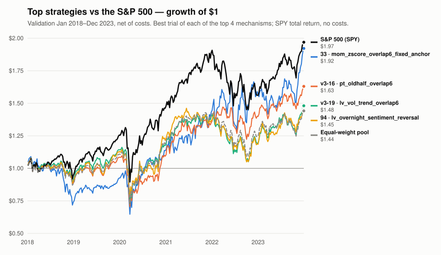

# Weekly Report — 2026-W45 (Nov 2–8)

**TL;DR.** Six trials ran across two nightly sessions (129 → 135 lifetime trials), all `GATE_FAIL`,
four in `range-variance` and two in `seasonality-calendar` — the other four nightly sessions ran zero
trials, each closing a measured research avenue rather than finding nothing to try. The week's real
news is methodological, not a strategy: one session found that the validation-skill statistic every
candidate is judged on is mostly driven by a six-year swing in the *benchmark*, not by the candidate,
which reframes five months of "the signal isn't there" readings as possibly "the ruler wobbles"; a
second pair of sessions caught the lab's own novelty/pre-trial screens inverting sign on roughly a
fifth of cases and fixed the policy (refuse on them, never use them to prefer a candidate). The
champion seat stays empty for a seventh straight week.

## Champion & trend

Unchanged for seven weeks. `strategies/champion_card.json` is still the stale v1 card for
`pt_mom_evar_arbrisk` (promoted #98): validation Sharpe 1.269, holdout Sharpe 1.411. It carries no
`protocol_version` marker and holds no seat under v3's cost model and skill-vs-pool metric. No
promotions or retirements this week; no holdout, forward or incubation file was read by any session.

The v3 board's best is still `pt_oldhalf_overlap6` (trial #16, `FAMILY_LEAD`, scout track):
validation skill +0.12, 90% CI [-0.11, +0.42], deflated-skill probability 0.1635 against the 0.95 a
promotion needs — unchanged this week, since none of the six new trials improved on it and all are
in tier 1 with every other trial on the board (the data cannot separate any of them).

## Trial activity this week

**6 trials, all `GATE_FAIL`, 4 in `range-variance` and 2 in `seasonality-calendar`, both nights'
hypotheses pre-registered as pairs testing one construction node each:**

| # | candidate | family | verdict | val skill | null %ile |
|---|---|---|---|---|---|
| v3-20 | `rv_clv_momneutral_overlap6` | range-variance | GATE_FAIL | +0.01 | 68% |
| v3-21 | `rv_clv_depthquota_control` | range-variance | GATE_FAIL | +0.01 | 66% |
| v3-22 | `sc_overnight_drift_sleeves` | seasonality-calendar | GATE_FAIL | +0.00 | 59% |
| v3-23 | `sc_overnight_return_control` | seasonality-calendar | GATE_FAIL | +0.01 | 62% |
| v3-24 | `rv_dcorr_low_overlap6` | range-variance | GATE_FAIL | **-0.30** | 0% |
| v3-25 | `rv_coskew_low_overlap6` | range-variance | GATE_FAIL | -0.19 | 0% |

Equal-weight pool validation Sharpe: +0.34. `distinct_mechanisms` stayed at **6**; `range-variance`
still has no recorded lead (`rv_clv_momneutral_overlap6` is its best at +0.01).

**No trials, four nights (Nov 1/2, 2/3, 3/4, 4/5).** Each closed a specific, named question rather
than finding nothing to do: the cost axis was bounded exactly (see learnings below); a literature
breadth concern (country/sector ETFs as the traded unit) was refused on the *benchmark*, not the
signal; one night was lost resolving a stranded per-run git branch (see "notable failures"); and the
regime-mix finding below came out of the fourth.

**Deflated-Sharpe bar.** Lifetime trial count is now **135** (104 v1, 6 v2, 25 v3), up from 129 last
week. The highest deflated-skill probability anywhere in the v3 record is still **0.1635**
(`pt_oldhalf_overlap6`), against the 0.95 gate a promotion needs.

## Top 3 learnings

1. **The six-year validation-skill number every candidate is judged on may be measuring the
   benchmark's regime swing more than the candidate.** A diagnostic run on eight stored v3 books
   found all eight negative on 2018–2021 and positive on 2022–2023 — including two mechanisms whose
   return streams correlate **-0.36**, which rules out one shared regime bet. For the board's best
   trial, its own Sharpe barely moved across that split (+0.463 → +0.469); the pool's Sharpe fell
   **0.648**. Its skill is negative in 51% of rolling two-year windows, and the benchmark's own 2-year
   swing (3.0 of Sharpe) is 6–7x the entire measured skill range of the board and the gate's own
   promotion gap. This doesn't mean the signal is there after all — it means five months of "the
   signal isn't there" readings, and every cost/breadth ceiling measured alongside them, are
   statements about one regime mix rather than about the panel, and nothing currently in the lab can
   tell the two apart. Flagged for the human owner, not acted on (thresholds and the engine are not a
   session's to touch).
2. **The lab's pre-trial screens (train Sharpe, train active-return correlation, rank correlation)
   all turn out to have the same one-sided shape: useful for refusing a candidate, useless or
   actively misleading for picking one.** The clearest single demonstration: a candidate that set
   four simultaneous "best ever" train-side records (highest train skill, highest matched-null score,
   widest sign-check margin, both historical sub-periods positive) came in as the board's
   second-worst validation result. Conversely, the one screen that *did* flag it in advance — correlating
   a candidate's own train return stream against already-tested, already-failed strategies — was
   right two times out of two this week; the lab's policy is now to use that screen only to veto, never
   to prefer. A side effect: the lab also learned that running "the same idea, slightly different
   construction" as a pair (five pairs tried since late October) almost never teaches anything new —
   the two legs' return streams correlate 0.85–0.98 regardless of score — so future sessions are
   switching to testing genuinely different ideas rather than variations on one.
3. **Trading costs are now bounded exactly, and it's a small number.** Measured across a 57-fold
   turnover range on both ETFs and stocks: `cost = 0.0134 × turnover − 0.0123` (in Sharpe units), so
   no construction or instrument choice can ever be worth more than **+0.0123** of skill (reached only
   at zero turnover) — about 3% of the gap to a promotion. A related test closed the idea of trading
   country or sector ETFs directly: every such basket is a -0.15 to -0.28 skill bet *before any
   stock-picking signal is applied*, because the lab's grading benchmark is a ~1,000-name
   equal-weighted stock pool and a market-cap-weighted ETF basket is close to the opposite portfolio
   of that — not a cost, breadth, or signal problem, a benchmark mismatch.

## Notable failures worth remembering

- **A textbook "this should work" candidate failed hardest.** `rv_dcorr_low_overlap6` (buy stocks
  that move least with the market on its worst days, after dividing out each stock's own
  volatility) scored training-period records on every metric the lab tracks and then validation
  skill of **-0.30**, the board's second-worst result — the cleanest proof yet that a strong
  training-period result here predicts almost nothing about the untouched validation years.
  Both of this week's worst two trials (`rv_dcorr_low_overlap6`, `rv_coskew_low_overlap6`) sat at
  the **0th percentile** of their own statistical null while the benchmark pool sat comfortably
  above it — 9 of the last 11 v3 trials have now been refused by that specific gate rather than by
  cost, drawdown, turnover, or survival. Flagged for the human owner as a possible severity question,
  not acted on.
- **A nightly session lost its night resolving a git housekeeping problem, not a research one.** The
  cloud runner hands each session a disposable per-run branch with an instruction to push only
  there, which conflicts with this repo's own "push to main" rule; this is the second time (of 14
  such branches created) that the conflict actually forked a session's work rather than landing
  harmlessly. No trial record was lost or duplicated — the stranded session had run zero trials — but
  it cost one full session to diagnose and merge. A one-line runner fix is flagged for the human
  owner; left unfixed, a future promoting session hitting the same conflict could split the trial
  count the deflated-Sharpe bar depends on.

## Suggested focus for next week

1. **Keep testing distinct scores, not construction variants of one score** — this week's and last
   week's paired trials confirm the two legs of a construction pair are statistically almost the same
   bet (0.85–0.98 correlated), so budget is better spent on mechanically different ideas.
2. **Use the train active-return screen only to veto, never to select**, per this week's 2-for-2
   (on refusal) / blind (on pass) finding — and do not revive train Sharpe, matched-null z, or
   sign-check margin as selection criteria; this week showed all three set simultaneous records on
   the board's second-worst result.
3. **A literature-based category prior (momentum-shaped mechanisms vs. frictions-shaped ones) is now
   proposed as the lab's main way to choose what to try next**, since train-side screens carry close
   to no information here (`corr(train skill, validation skill)` ≈ +0.05 over 19 trials) — almost
   every v3 trial run so far has been frictions-shaped.
4. **For the human owner, unresolved from this week:** whether the regime-mix finding changes how the
   validation window or the promotion gate should be read; the per-run-branch/`git push origin main`
   conflict (two forks out of 14 branches so far); and the standing items carried from prior weeks
   (the back-adjusted-price and volume-level engine issues, the empirical-Bayes shrinkage question for
   the deflated-Sharpe bar, and the 90th-percentile null severity question above).

## Permanent caveat

This research runs on survivorship-biased, free end-of-day data with modeled (not live) execution and
costs. It is research output, not investment advice.

---

<!-- weekly_board.py output, pasted verbatim -->

## Strategy leaderboard — every evaluated strategy

_Generated by `scripts/weekly_board.py` from stored validation returns (2018–2023, 1562 days): v3 trials as recorded, v1/v2 trials from their protocol-v3 re-scoring. Nothing was re-run; no holdout data was read._

| line | trial | val Sharpe | skill [90% CI] | total return | CAGR | volatility | max drawdown |
|---|---|---|---|---|---|---|---|
| strategy | `33 mom_zscore_overlap6_fixed_anchor` (M1) | +0.49 | +0.16 [-0.44, +0.65] | +92% | +11.1% | 23.2% | -41% |
| strategy | `v3-16 pt_oldhalf_overlap6` (M2) | +0.46 | +0.12 [-0.11, +0.42] | +63% | +8.2% | 15.9% | -37% |
| strategy | `v3-19 lv_vol_trend_overlap6` (M11) | +0.36 | +0.02 [-0.10, +0.14] | +48% | +6.5% | 16.5% | -39% |
| strategy | `94 lv_overnight_sentiment_reversal` (M7) | +0.34 | +0.00 [-0.25, +0.22] | +45% | +6.2% | 16.2% | -33% |
| benchmark | S&P 500 (SPY) | +0.56 | +0.22 [-0.11, +0.51] — a gap, not skill | +97% | +11.6% | 20.0% | -34% |
| benchmark | Equal-weight pool | +0.34 | +0.00 (the baseline) | +44% | +6.1% | 15.9% | -37% |

Sharpe is in excess of T-bills. **Skill is Sharpe minus the equal-weight pool's**, the number every strategy here is judged on; the S&P 500 is shown for orientation, not as the bar. Its row shows Sharpe minus the pool's with the same interval — a gap, not skill: SPY holds US large caps weighted by size, a region and size bet the random-selection null does not credit. It is also roughly the skill a strategy would need to match the S&P's Sharpe.

**How to read the ranking.** Sorted by tier, then skill. Tier 1 is the set the data cannot separate from the best (10% model confidence set) — **order inside tier 1 is not evidence**. Tier 2 is outside it with a skill interval above zero; tier 3 is everything else. "vs pool" reads the 90% interval: better / worse only when the whole interval is on one side of zero; "vs S&P" reads the paired 90% interval of the trial's Sharpe minus SPY's the same way (SPY itself is never ranked or tiered). "mech." groups trials whose active returns correlate ≥ 0.5 — one mechanism under several labels is one bet. Verdict is as recorded, under the protocol version shown.

Equal-weight pool validation Sharpe: +0.34. 107 of 107 trials are in tier 1. Against the S&P 500 (+0.22 over the pool), 0 are better and 25 worse with confidence; the rest can't be told apart from it.

### A. All 107 ranked trials

| # | tier | trial | strategy | family | verdict | mech. | val Sharpe | skill [90% CI] | vs pool | vs S&P | what it does |
|---|---|---|---|---|---|---|---|---|---|---|---|
| 1 | 1 | 33 | `mom_zscore_overlap6_fixed_anchor` | cross-sectional momentum | REJECT (v1) | M1 | +0.49 | +0.16 [-0.44, +0.65] | can't tell | can't tell | The six-month blend, sizing each stock against a fixed yardstick so positions don't all shift just because the weakest holding changed. |
| 2 | 1 | 39 | `mom_zscore_overlap6_market_trim` | regime switching | REJECT (v1) | M1 | +0.49 | +0.15 [-0.55, +0.76] | can't tell | can't tell | Triggers the safety cut-back from the swings of the whole market rather than the portfolio's own. |
| 3 | 1 | 37 | `mom_zscore_overlap6_trim_universe` | cross-sectional momentum | REJECT (v1) | M1 | +0.48 | +0.15 [-0.56, +0.73] | can't tell | can't tell | Fixes the safety cut-back to watch the swings of every stock actually held, not just the few with very long price histories. |
| 4 | 1 | 42 | `mom_zscore_overlap6_hzn_avg4` | cross-sectional momentum | PROMOTE (v1) | M1 | +0.48 | +0.14 [-0.44, +0.61] | can't tell | can't tell | Builds four winners portfolios, judged on gains over 12, 9, 6 and 3 months, and holds a quarter of each, blended over six months, with the safety cut-back. |
| 5 | 1 | 46 | `mom_hzn_avg4_k6_cohort_trim` | cross-sectional momentum | REJECT (v1) | M1 | +0.48 | +0.14 [-0.44, +0.61] | can't tell | can't tell | Like #45 (four-window winners, market-wide safety cut-back), but with the six-month blending of monthly picks switched back on. |
| 6 | 1 | 34 | `mom_zscore_overlap6_live_tranche` | cross-sectional momentum | REJECT (v1) | M1 | +0.47 | +0.14 [-0.62, +0.77] | can't tell | can't tell | The six-month blend, but older picks that the latest ranking no longer likes are dropped and their money goes to names still in favour. |
| 7 | 1 | 32 | `mom_zscore_overlap6_daily_trim` | cross-sectional momentum | REJECT (v1) | M1 | +0.47 | +0.13 [-0.54, +0.69] | can't tell | can't tell | Recent winners, but only one-sixth of the portfolio is rebuilt each month, so it blends picks from the last six months and trades less. (Run twice; the second run was promoted.) |
| 8 | 1 | 35 | `mom_zscore_overlap6_daily_trim` | cross-sectional momentum | PROMOTE (v1) | M1 | +0.47 | +0.13 [-0.54, +0.69] | can't tell | can't tell | Recent winners, but only one-sixth of the portfolio is rebuilt each month, so it blends picks from the last six months and trades less. (Run twice; the second run was promoted.) |
| 9 | 1 | 38 | `mom_zscore_overlap6_notrim` | cross-sectional momentum | REJECT (v1) | M1 | +0.47 | +0.13 [-0.54, +0.69] | can't tell | can't tell | The six-month blend with the safety cut-back removed entirely, to test whether it was doing any real work. |
| 10 | 1 | 40 | `mom_zscore_overlap6_legacy_trim` | regime switching | REJECT (v1) | M1 | +0.47 | +0.13 [-0.54, +0.69] | can't tell | can't tell | Triggers the safety cut-back from the swings of the long-established stocks, whether held or not. |
| 11 | 1 | 41 | `mom_zscore_overlap6_hzn_avg` | cross-sectional momentum | PROMOTE (v1) | M1 | +0.46 | +0.13 [-0.49, +0.62] | can't tell | can't tell | Builds two separate winners portfolios, one judged on 12-month gains and one on 6-month gains, and holds half of each. |
| 12 | 1 | v3-16 | `pt_oldhalf_overlap6` | price-trend | FAMILY_LEAD (v3) | M2 | +0.46 | +0.12 [-0.11, +0.42] | can't tell | can't tell | The older-half bet (v3-12), held in six overlapping monthly batches that are each refreshed in turn and carried for six months, instead of rebuilding the whole book every month — the same picks, but less trading. |
| 13 | 1 | 61 | `sl_ridge_nontrend_block` | statistical-learning | FAMILY_LEAD (v1) | M2 | +0.46 | +0.12 [-0.22, +0.41] | can't tell | can't tell | A simple statistical model, retrained monthly on past data only, fed four clues that ignore past-year trends: calendar month, ease of trading, unusual volume and last month's drop. |
| 14 | 1 | v3-17 | `pt_oldhalf_sync6` | price-trend | SCOUT (v3) | M2 | +0.44 | +0.11 [-0.12, +0.37] | can't tell | can't tell | A comparison test: holds the same six months' worth of picks as v3-16, but rebuilds the whole combined book fresh every month instead of carrying old batches, to separate "trading less" from "smoothing the picks". |
| 15 | 1 | 36 | `mom_zscore_overlap6_ddbrake` | regime switching | REJECT (v1) | M1 | +0.43 | +0.10 [-0.60, +0.70] | can't tell | can't tell | Adds a second brake: drop to 60% once the portfolio is 20% below its peak, and return to full size after it recovers to within 10%. |
| 16 | 1 | 53 | `mom_hzn_avg4_noagree` | cross-sectional momentum | REJECT (v1) | M1 | +0.43 | +0.09 [-0.47, +0.54] | can't tell | can't tell | Four-window winners without the extra money for stocks that several of the four windows pick at once. |
| 17 | 1 | v3-15 | `pt_old_half_ex_phase6_control` | price-trend | GATE_FAIL (v3) | M2 | +0.42 | +0.09 [-0.13, +0.33] | can't tell | can't tell | A comparison test: the same kind of removal as v3-14, but dropping the five months exactly opposite in the calendar instead of the matching ones, to check whether which months get dropped actually matters. |
| 18 | 1 | 50 | `mom_hzn_avg4_no_resize` | cross-sectional momentum | REJECT (v1) | M1 | +0.41 | +0.07 [-0.50, +0.51] | can't tell | can't tell | Never resizes a stock it already holds; it grows or shrinks with its price, and only new arrivals are sized fresh. |
| 19 | 1 | v3-12 | `pt_decade_old_half_depth_neutral` | price-trend | FAMILY_LEAD (v3) | M2 | +0.41 | +0.07 [-0.17, +0.35] | can't tell | can't tell | The ten-year-flat-price bet, but scored only on the older half of that span (five to ten years back) instead of the whole ten years, after finding the newer half carried no useful signal on its own. |
| 20 | 1 | 22 | `mom_multihorizon_zscore_damped_buffered` | cross-sectional momentum | REJECT (v1) | M1 | +0.41 | +0.07 [-0.53, +0.59] | can't tell | can't tell | The two-window winners basket, with the gap between big and small positions softened so no stock takes too large a slice. |
| 21 | 1 | 65 | `pt_raw_reversal_control` | price-trend | FAMILY_LEAD (v1) | M2 | +0.40 | +0.06 [-0.31, +0.37] | can't tell | can't tell | A comparison test: buys last month's biggest losers with no volume adjustment, to check whether #64's adjustment is what helped. |
| 22 | 1 | 47 | `mom_hzn_avg4_subsample_bag3` | combinations | REJECT (v1) | M1 | +0.40 | +0.06 [-0.50, +0.50] | can't tell | can't tell | Runs the four-window strategy three times, each time hiding a different third of the stocks, and holds the average of the three. |
| 23 | 1 | 54 | `mom_hzn_avg4_rankweight` | cross-sectional momentum | REJECT (v1) | M1 | +0.39 | +0.06 [-0.49, +0.51] | can't tell | can't tell | Four-window winners, sized by place in the ranking (1st gets most) rather than by how far each stock stands out. |
| 24 | 1 | 52 | `mom_hzn_avg4_equalweight` | cross-sectional momentum | REJECT (v1) | M1 | +0.38 | +0.05 [-0.47, +0.47] | can't tell | can't tell | Four-window winners with equal money in every chosen stock, instead of more money in the strongest. |
| 25 | 1 | 21 | `mom_multihorizon_zscore_buffered` | cross-sectional momentum | REJECT (v1) | M1 | +0.38 | +0.04 [-0.62, +0.63] | can't tell | can't tell | Recent winners, sized by how far each stock's gain stands out, judged on 6-month and 12-month gains together so no single time window decides. |
| 26 | 1 | 28 | `mom_zscore_narrow_daily_volspike_trim` | cross-sectional momentum | REJECT (v1) | M1 | +0.38 | +0.04 [-0.62, +0.63] | can't tell | can't tell | The daily safety cut-back applied to the narrower 15–25-stock winners basket. |
| 27 | 1 | 29 | `mom_zscore_volspike_hedge_redirect` | cross-sectional momentum | REJECT (v1) | M1 | +0.38 | +0.04 [-0.62, +0.63] | can't tell | can't tell | When the safety cut-back kicks in, the freed money goes into long-term government bonds and gold instead of sitting in cash. |
| 28 | 1 | 55 | `mom_hzn_disjoint4_overlap6` | cross-sectional momentum | REJECT (v1) | M1 | +0.37 | +0.04 [-0.36, +0.34] | can't tell | can't tell | Judges winners on four separate, non-overlapping quarters of the past year instead of four nested windows. |
| 29 | 1 | 86 | `pt_depth_breadth_pinned` | price-trend | SCOUT (v1) | M1 | +0.37 | +0.04 [-0.50, +0.45] | can't tell | can't tell | Like #85 (one fresh winners list, read deeper), re-tuned so the holding count matches the champion's in the period that is scored. |
| 30 | 1 | 85 | `pt_depth_vs_vintage_breadth` | price-trend | FAMILY_LEAD (v1) | M1 | +0.37 | +0.04 [-0.52, +0.47] | can't tell | can't tell | Gets the champion's number of holdings by going further down one fresh winners list, instead of blending lists from different months. |
| 31 | 1 | 43 | `mom_zscore_hzn_avg4_k1` | cross-sectional momentum | PROMOTE (v1) | M1 | +0.37 | +0.03 [-0.58, +0.51] | can't tell | can't tell | The four-window winners portfolio, rebuilt in full every month instead of one-sixth at a time. |
| 32 | 1 | 45 | `mom_hzn_avg4_k1_cohort_trim` | regime switching | PROMOTE (v1) | M1 | +0.37 | +0.03 [-0.58, +0.51] | can't tell | can't tell | The four-window portfolio with the safety cut-back driven by the swings of all long-established stocks, not just the few it holds. |
| 33 | 1 | 12 | `str_reversal_monthly` | short-term mean reversion | REJECT (v1) | M2 | +0.37 | +0.03 [-0.39, +0.37] | can't tell | can't tell | Each month, buys the stocks that fell most over the past month, betting they bounce back. |
| 34 | 1 | 51 | `mom_hzn_avg4_nobuffer` | cross-sectional momentum | PROMOTE (v1) | M1 | +0.36 | +0.02 [-0.60, +0.52] | can't tell | can't tell | Four-window winners, but each of the four portfolios simply holds its current top 15, with no "keep until it drops to 25" rule. |
| 35 | 1 | v2-3 | `sa_pca_resid_reversion` | statistical-arbitrage | FAMILY_LEAD (v2) | M2 | +0.36 | +0.02 [-0.30, +0.30] | can't tell | can't tell | Buys the 30 stocks that fell furthest compared with what similar stocks (same region, sector, style) did last month, betting the gap closes. |
| 36 | 1 | v3-14 | `pt_old_half_ex_anniversary` | price-trend | SCOUT (v3) | M2 | +0.36 | +0.02 [-0.20, +0.28] | can't tell | can't tell | The older-half bet (v3-12), with the five months that share the same calendar month as the one about to be held removed from the score, on the idea that same-month history behaves differently from the rest. |
| 37 | 1 | v3-19 | `lv_vol_trend_overlap6` | liquidity-volume | GATE_FAIL (v3) | M11 | +0.36 | +0.02 [-0.10, +0.14] | can't tell | can't tell | The drying-up-trading bet (v3-18), held in six overlapping monthly batches instead of rebuilt fresh each month, to trade less for the same picks. |
| 38 | 1 | v2-1 | `pt_resid_reversal_v2` | price-trend | GATE_FAIL (v2) | M2 | +0.35 | +0.02 [-0.32, +0.30] | can't tell | can't tell | Buys the 30 stocks that fell furthest behind the average stock over the past month, betting they bounce back; refreshed monthly. |
| 39 | 1 | v3-18 | `lv_vol_trend_hold1` | liquidity-volume | GATE_FAIL (v3) | M11 | +0.35 | +0.01 [-0.10, +0.14] | can't tell | can't tell | Buys the 100 stocks whose trading activity has been drying up the most over several years compared with their own past, betting that becoming harder to trade earns extra return. |
| 40 | 1 | v3-20 | `rv_clv_momneutral_overlap6` | range-variance | GATE_FAIL (v3) | M2 | +0.35 | +0.01 [-0.22, +0.29] | can't tell | can't tell | Buys the 100 stocks that have most persistently finished the day near the bottom of that day's own trading range, on the idea that closing weakness is end-of-day selling pressure rather than news, and pressure fades. |
| 41 | 1 | v3-23 | `sc_overnight_return_control` | seasonality-calendar | GATE_FAIL (v3) | M1 | +0.35 | +0.01 [-0.16, +0.18] | can't tell | can't tell | A comparison test: the same overnight bet as v3-22, but measuring the overnight move as a plain percentage return instead of as a share of the day's range, to check whether that scaling choice mattered. |
| 42 | 1 | v3-21 | `rv_clv_depthquota_control` | range-variance | GATE_FAIL (v3) | M2 | +0.34 | +0.01 [-0.27, +0.31] | can't tell | can't tell | A comparison test: the same closing-near-the-low bet as v3-20, but spreading the picks across groups defined by how much price history each stock has instead of by its past-year return, to check whether that grouping choice mattered. |
| 43 | 1 | v2-6 | `lv_resid_rev_illiq_tilt` | liquidity-volume | FAMILY_LEAD (v2) | M2 | +0.34 | +0.01 [-0.37, +0.31] | can't tell | can't tell | The look-alike bounce-back bet (v2-3), tilted toward thinly traded stocks, where forced selling is thought to push prices furthest. |
| 44 | 1 | 44 | `mom_zscore_hzn_geom4_k1` | cross-sectional momentum | REJECT (v1) | M1 | +0.34 | +0.01 [-0.59, +0.48] | can't tell | can't tell | The four-window portfolio with the windows spaced 12, 7.5, 5 and 3 months, so each is a similar step shorter than the last. |
| 45 | 1 | 24 | `mom_multihorizon_zscore_widebreadth` | cross-sectional momentum | REJECT (v1) | M1 | +0.34 | +0.00 [-0.62, +0.53] | can't tell | can't tell | The two-window winners basket, but holding more stocks (about 20–35 instead of 15–25) to spread the risk. |
| 46 | 1 | 25 | `mom_zscore_volspike_trim` | cross-sectional momentum | REJECT (v1) | M1 | +0.34 | +0.00 [-0.62, +0.53] | can't tell | can't tell | The wider winners basket plus the safety cut-back, triggered by the basket's own swings and checked once a month. |
| 47 | 1 | 26 | `mom_zscore_daily_volspike_trim` | cross-sectional momentum | REJECT (v1) | M1 | +0.34 | +0.00 [-0.62, +0.53] | can't tell | can't tell | Recent winners with the safety cut-back checked every day, so it can react to a crash within days instead of weeks. (A bug kept stocks it meant to sell in the book; see #27.) |
| 48 | 1 | 27 | `mom_zscore_daily_volspike_trim_fixed` | cross-sectional momentum | REJECT (v1) | M1 | +0.34 | +0.00 [-0.62, +0.53] | can't tell | can't tell | Recent winners with the safety cut-back checked daily: a corrected re-run of #26, which had a bug. |
| 49 | 1 | v3-22 | `sc_overnight_drift_sleeves` | seasonality-calendar | GATE_FAIL (v3) | M1 | +0.34 | +0.00 [-0.15, +0.14] | can't tell | can't tell | Buys the 100 stocks that have gained the least while the exchange was shut, measured as a share of their own daily price range, on the idea that overnight gains are attention-driven demand that later fades. |
| 50 | 1 | 20 | `mom_zscore_weighted_buffered` | cross-sectional momentum | REJECT (v1) | M1 | +0.34 | +0.00 [-0.71, +0.61] | can't tell | can't tell | The low-trading winners basket, sizing each stock by how far its gain stands out from the crowd, not just its place in line. |
| 51 | 1 | 94 | `lv_overnight_sentiment_reversal` | liquidity-volume | SCOUT (v1) | M7 | +0.34 | +0.00 [-0.25, +0.22] | can't tell | can't tell | Buys stocks with the weakest overnight price moves last month, betting that mood-driven selling unwinds over the following year. |
| 52 | 1 | 64 | `lv_trading_time_reversal` | liquidity-volume | SCOUT (v1) | M2 | +0.33 | -0.01 [-0.41, +0.31] | can't tell | can't tell | Buys last month's losers, counting price drops on quiet days more heavily than drops on heavy-volume days. |
| 53 | 1 | v3-5 | `pt_decade_reversal_peer_neutral` | price-trend | GATE_FAIL (v3) | M2 | +0.33 | -0.01 [-0.29, +0.28] | can't tell | can't tell | Buys the 100 big, long-established stocks whose prices have gone nowhere on average for ten years, picked region by region so the book's country mix matches the market. |
| 54 | 1 | 16 | `mom_str_reversal_buffered` | combinations | REJECT (v1) | M1 | +0.33 | -0.01 [-0.50, +0.37] | can't tell | can't tell | The 80/20 winners-plus-bounce-back mix, but a stock already held is kept until it slips well down the ranking, to cut trading. |
| 55 | 1 | 73 | `pl_2leg_content_partner` | portfolio-learning | SCOUT (v1) | M2 | +0.33 | -0.01 [-0.30, +0.27] | can't tell | can't tell | The top 10 by calendar-month score plus the top 10 of last month's losers. |
| 56 | 1 | 19 | `mom_rankweighted_buffered` | cross-sectional momentum | REJECT (v1) | M1 | +0.32 | -0.02 [-0.66, +0.52] | can't tell | can't tell | The low-trading winners basket, putting more money in the higher-ranked stocks and less in the lower-ranked. |
| 57 | 1 | 15 | `mom_str_reversal_composite` | combinations | REJECT (v1) | M1 | +0.31 | -0.02 [-0.61, +0.47] | can't tell | can't tell | Scores each stock mostly on its past-year gain and partly on its last-month drop, and buys the top 15 of that single list. |
| 58 | 1 | v3-1 | `pt_lowvol_gk_quarterly` | price-trend | GATE_FAIL (v3) | M1 | +0.30 | -0.03 [-0.26, +0.21] | can't tell | can't tell | Holds the 100 calmest stocks (smallest price swings over the past year) in equal amounts, rebalancing only four times a year. |
| 59 | 1 | v3-6 | `pl_decade_invvol_floored` | portfolio-learning | GATE_FAIL (v3) | M2 | +0.30 | -0.04 [-0.31, +0.23] | can't tell | can't tell | The ten-year-flat-price stock picks (v3-5), but sized to put a little less money in the jumpier names and a little more in the calmer ones, with a floor so no single stock gets too tiny a stake. |
| 60 | 1 | 14 | `mom_str_reversal_blend` | combinations | REJECT (v1) | M1 | +0.30 | -0.04 [-0.55, +0.35] | can't tell | can't tell | 80% in last year's biggest winners and 20% in last month's biggest losers: two bets that tend to pay at different times. |
| 61 | 1 | 48 | `mom_hzn_avg4_phase4` | combinations | REJECT (v1) | M1 | +0.29 | -0.05 [-0.65, +0.43] | can't tell | can't tell | Runs the four-window strategy four times, rebalancing on different days of the month (1st, 8th, 15th, 22nd), and holds the average. |
| 62 | 1 | 10 | `mom_etf_volweighted_blend` | combinations | REJECT (v1) | M1 | +0.29 | -0.05 [-0.50, +0.32] | can't tell | can't tell | Splits money between recent winners and a fixed fund mix, shifting toward the funds whenever the winners get bumpy. |
| 63 | 1 | 3 | `ew_global_etf` | volatility targeting / risk parity | REJECT (v1) | M1 | +0.29 | -0.05 [-0.47, +0.30] | can't tell | can't tell | Holds equal amounts of a fixed set of global stock, bond, commodity and emerging-market funds, and never changes the mix. |
| 64 | 1 | v3-3 | `lv_illiq_peer_neutral_band` | liquidity-volume | GATE_FAIL (v3) | M2 | +0.28 | -0.05 [-0.27, +0.15] | can't tell | can't tell | The hard-to-trade-stocks bet, built region by region so no single country or exchange dominates the book, and holds a stock until it drops out of the worst 200. |
| 65 | 1 | v3-8 | `sl_gbm_seven_nonlinear` | statistical-learning | GATE_FAIL (v3) | M2 | +0.28 | -0.06 [-0.27, +0.10] | can't tell | can't tell | The lab's seven-measurement stock-picking model, but with its simple add-the-clues-up rule swapped for a more flexible tree-based one that can react to combinations of the measurements. |
| 66 | 1 | v3-11 | `pt_decade_reversal_band_warm` | price-trend | GATE_FAIL (v3) | M2 | +0.28 | -0.06 [-0.35, +0.24] | can't tell | can't tell | The ten-year-flat-price picks (v3-5), but a stock stays in the book until it drops out of the worst 200 instead of being sold the moment a fresher pick out-scores it, to cut needless trading. |
| 67 | 1 | 18 | `mom_buffered_etf_blend` | combinations | REJECT (v1) | M1 | +0.28 | -0.06 [-0.65, +0.40] | can't tell | can't tell | 80% in the low-trading winners basket and 20% in a fixed mix of diversified funds. |
| 68 | 1 | 17 | `mom_12m_buffered` | cross-sectional momentum | REJECT (v1) | M1 | +0.27 | -0.07 [-0.69, +0.43] | can't tell | can't tell | Recent winners, but a stock already held is kept until it drops out of the top 25 rather than the top 15, which cuts needless trading. |
| 69 | 1 | 30 | `mom_12m_daily_volspike_trim` | cross-sectional momentum | REJECT (v1) | M1 | +0.27 | -0.07 [-0.69, +0.43] | can't tell | can't tell | The plain, equal-sized recent-winners basket with the daily safety cut-back added. |
| 70 | 1 | v3-13 | `pt_decade_recent_half_control` | price-trend | GATE_FAIL (v3) | M2 | +0.27 | -0.07 [-0.34, +0.19] | can't tell | can't tell | A comparison test: the same bet as v3-12, but scored on the newer half of the ten-year window instead of the older half, to check that the older half really is where the signal lives. |
| 71 | 1 | 9 | `mom_etf_blend` | combinations | REJECT (v1) | M1 | +0.24 | -0.10 [-0.70, +0.39] | can't tell | can't tell | 80% in recent winners and 20% in a fixed mix of diversified funds, to soften the winners' sharp crashes. |
| 72 | 1 | 49 | `mom_hzn_avg4_weekly_resize` | cross-sectional momentum | REJECT (v1) | M1 | +0.24 | -0.10 [-0.69, +0.38] | can't tell | can't tell | Resets position sizes to the latest scores every week, instead of letting them drift with prices for a month. |
| 73 | 1 | 95 | `rv_sleeve_voltarget_phi05` | range-variance | SCOUT (v1) | M1 | +0.24 | -0.10 [-0.33, +0.13] | can't tell | worse | Holds equal amounts of 42 funds, cutting the total stake when markets get jumpy, but adjusting it slowly to avoid costly trading. |
| 74 | 1 | 1 | `mom_12m_baseline` | cross-sectional momentum | PROMOTE (v1) | M1 | +0.23 | -0.11 [-0.74, +0.41] | can't tell | can't tell | Each month, buys the 15 stocks that rose most over the past year (ignoring the latest month), betting that winners keep winning. |
| 75 | 1 | 93 | `pl_factor_momentum_untimed` | portfolio-learning | SCOUT (v1) | M6 | +0.23 | -0.11 [-0.33, +0.05] | can't tell | can't tell | A comparison test: the same twelve stock-picking styles, all held all the time. |
| 76 | 1 | v3-2 | `sa_resid_rev63_band` | statistical-arbitrage | GATE_FAIL (v3) | M2 | +0.22 | -0.12 [-0.32, +0.04] | can't tell | can't tell | Buys the 100 stocks that have drifted furthest below what the market's main patterns say they should be worth over the past quarter, betting the gap closes; keeps a stock as long as it's still among the worst 200, to cut needless trading. |
| 77 | 1 | 5 | `gtaa_trend_diversified` | time-series momentum / trend following | REJECT (v1) | M1 | +0.21 | -0.13 [-0.71, +0.39] | can't tell | can't tell | Equal amounts across many types of fund; any fund below its 200-day average price is swapped into a mix of bond funds. |
| 78 | 1 | v2-5 | `sl_ridge_six_masked` | statistical-learning | GATE_FAIL (v2) | M2 | +0.19 | -0.15 [-0.45, +0.13] | can't tell | can't tell | The same learned model with the future-information leak fixed. |
| 79 | 1 | v3-10 | `sa_coint_slope_volneutral` | statistical-arbitrage | GATE_FAIL (v3) | M10 | +0.18 | -0.15 [-0.37, +0.01] | can't tell | worse | Buys the 100 stocks most tightly tied to the long-run trend of their peer group, with the calmest and jumpiest stocks evened out so the bet isn't secretly just "buy the calm ones". |
| 80 | 1 | 100 | `rv_minvar_equalweight` | range-variance | FAMILY_LEAD (v1) | M1 | +0.17 | -0.17 [-0.55, +0.18] | can't tell | can't tell | The same calm, market-insensitive stocks the lowest-swing formula (#99) picks, but with equal money in each. |
| 81 | 1 | 74 | `pl_2leg_null_partner` | portfolio-learning | SCOUT (v1) | M2 | +0.16 | -0.17 [-0.46, +0.05] | can't tell | worse | The top 10 by calendar-month score plus the top 10 by unusual trading volume, a score that predicts nothing on its own. |
| 82 | 1 | v3-25 | `rv_coskew_low_overlap6` | range-variance | GATE_FAIL (v3) | M12 | +0.14 | -0.19 [-0.35, -0.05] | worse | worse | Buys the 100 stocks that have most reliably fallen when the market as a whole turned turbulent, on the theory that an investor must be paid extra to hold something that makes a diversified portfolio's worst outcomes worse. |
| 83 | 1 | 2 | `gtaa_trend_etf` | time-series momentum / trend following | GATE_FAIL (v1) | M1 | +0.14 | -0.20 [-0.86, +0.37] | can't tell | can't tell | Holds a spread of stock, bond and commodity funds, but swaps any fund trading below its 200-day average price into government bonds. |
| 84 | 1 | 66 | `pt_fast_reversal_slow_grid` | price-trend | SCOUT (v1) | M2 | +0.12 | -0.22 [-0.52, +0.11] | can't tell | can't tell | Buys last week's biggest losers, but only trades once a month to keep costs down. |
| 85 | 1 | 91 | `rv_volofvol_top15` | range-variance | FAMILY_LEAD (v1) | M5 | +0.12 | -0.22 [-0.72, +0.16] | can't tell | worse | Buys the 15 stocks whose jumpiness itself changes the most from month to month. |
| 86 | 1 | 56 | `sl_ridge_xs_walkforward` | statistical-learning | FAMILY_LEAD (v1) | M2 | +0.11 | -0.22 [-0.62, +0.13] | can't tell | worse | A simple statistical model, retrained monthly on past data only, combines 11 price and trading-volume clues to pick the 20 stocks it expects to do best next month. |
| 87 | 1 | 31 | `mom_52wkhigh_zscore_buffered` | cross-sectional momentum | REJECT (v1) | M1 | +0.11 | -0.23 [-0.73, +0.22] | can't tell | worse | Picks the stocks trading closest to their highest price of the past year, instead of those with the biggest gains. |
| 88 | 1 | v2-2 | `pt_resid_reversal_band` | price-trend | GATE_FAIL (v2) | M2 | +0.11 | -0.23 [-0.46, -0.03] | worse | worse | The same bounce-back bet, but skips the 30 most extreme fallers and buys the next 90, hoping for a smoother ride. |
| 89 | 1 | v3-4 | `rv_arbrisk_peer_neutral` | range-variance | GATE_FAIL (v3) | M1 | +0.10 | -0.23 [-0.54, +0.02] | can't tell | worse | Buys the 100 stocks whose price moves are hardest for similar stocks to hedge against, picked region by region so the book's country mix matches the overall market. |
| 90 | 1 | 63 | `sa_pca_residual_excursion` | statistical-arbitrage | FAMILY_LEAD (v1) | M4 | +0.09 | -0.24 [-0.38, -0.12] | worse | worse | Buys stocks that have drifted unusually far below where similar stocks say they should be, and sells once they snap back. |
| 91 | 1 | 8 | `risk_parity_multi_asset` | volatility targeting / risk parity | REJECT (v1) | M1 | +0.09 | -0.25 [-0.72, +0.19] | can't tell | worse | Spreads money across fund types so each adds about the same amount of risk (less money in the jumpier ones). |
| 92 | 1 | 13 | `mom_lowvol_doublesort` | low-volatility / quality tilts | REJECT (v1) | M1 | +0.07 | -0.26 [-0.84, +0.26] | can't tell | worse | Among the past year's best performers, buys only the calmest, to avoid the winners most likely to crash. |
| 93 | 1 | v3-7 | `sc_weekday_mood_band` | seasonality-calendar | GATE_FAIL (v3) | M9 | +0.07 | -0.27 [-0.51, -0.01] | worse | worse | Buys the 100 stocks whose own Monday returns have lagged the rest of the week the most, picked region by region and held until they drop out of the worst 200. |
| 94 | 1 | 75 | `pl_2leg_placebo_partner` | portfolio-learning | SCOUT (v1) | M1 | +0.07 | -0.27 [-0.59, -0.00] | worse | worse | The top 10 by calendar-month score plus 10 stocks chosen by a fixed random draw, to test whether the second half needs any real idea. |
| 95 | 1 | v3-24 | `rv_dcorr_low_overlap6` | range-variance | GATE_FAIL (v3) | M1 | +0.04 | -0.30 [-0.65, -0.02] | worse | worse | Buys the 100 stocks whose price has moved least in step with the wider market specifically on the market's bad days, having first divided out how jumpy each stock is on its own, on the idea that shelter in a falling market is a service investors pay for. |
| 96 | 1 | 6 | `lowvol_equity_tilt` | low-volatility / quality tilts | REJECT (v1) | M1 | +0.03 | -0.30 [-0.84, +0.21] | can't tell | can't tell | Buys the stocks whose prices have moved around the least over the past six months, betting calm stocks pay more per unit of risk. |
| 97 | 1 | 101 | `ll_peer_momentum` | lead-lag-spillover | SCOUT (v1) | M8 | +0.03 | -0.30 [-0.94, +0.26] | can't tell | can't tell | Buys stocks whose closest look-alikes rose most last month, betting the stock follows its peers. |
| 98 | 1 | 11 | `str_reversal_stocks` | short-term mean reversion | GATE_FAIL (v1) | M2 | +0.02 | -0.32 [-0.83, +0.12] | can't tell | worse | Each week, buys the stocks that fell most over the past week, betting short-term drops bounce back. |
| 99 | 1 | 4 | `mom_invvol_target` | cross-sectional momentum | REJECT (v1) | M1 | +0.01 | -0.33 [-0.91, +0.22] | can't tell | worse | Recent winners, but with less money in the jumpiest stocks, and the whole position is scaled down when the portfolio gets too bumpy. |
| 100 | 1 | v3-9 | `ll_peer_delay_band` | lead-lag-spillover | GATE_FAIL (v3) | M1 | -0.00 | -0.34 [-0.51, -0.18] | worse | worse | Buys the 100 stocks whose price moves lag their closest look-alikes by about a week, picked region by region, betting slow-to-react stocks catch up later. |
| 101 | 1 | 102 | `ll_peer_momentum_evargate` | lead-lag-spillover | SCOUT (v1) | M8 | -0.02 | -0.36 [-1.03, +0.22] | can't tell | worse | Follow-your-peers, but only for stocks that really move with their look-alikes. |
| 102 | 1 | 92 | `pl_factor_momentum_timed` | portfolio-learning | SCOUT (v1) | M6 | -0.05 | -0.39 [-0.70, -0.16] | worse | worse | Holds twelve simple stock-picking styles, but only those that beat the market over the past year. |
| 103 | 1 | 59 | `sc_same_month_seasonal` | seasonality-calendar | FAMILY_LEAD (v1) | M1 | -0.06 | -0.39 [-0.78, -0.10] | worse | worse | Buys the 25 stocks that have historically done best in the calendar month about to start, compared with their other months. |
| 104 | 1 | 7 | `mom_regime_filtered` | regime switching | REJECT (v1) | M1 | -0.10 | -0.44 [-1.18, +0.23] | can't tell | worse | Recent winners, but moves entirely into bonds whenever the US stock market is below its 200-day average. |
| 105 | 1 | 57 | `lv_amihud_illiquidity_tilt` | liquidity-volume | FAMILY_LEAD (v1) | M3 | -0.13 | -0.47 [-0.90, -0.13] | worse | worse | Buys the 20 stocks that are hardest to trade (their price moves most per dollar traded), betting investors are paid extra for holding them. |
| 106 | 1 | 60 | `sc_same_month_seasonal_aligned` | seasonality-calendar | FAMILY_LEAD (v1) | M1 | -0.14 | -0.48 [-0.91, -0.14] | worse | worse | A corrected re-run of the calendar-month idea: the first attempt sometimes looked up the month that had just ended instead of the one about to start. |
| 107 | 1 | 99 | `rv_minvar_closedform` | range-variance | SCOUT (v1) | M1 | -0.26 | -0.60 [-1.31, +0.00] | can't tell | worse | Holds the mix of calm, market-insensitive stocks that a standard formula says gives the smallest swings, with more money in the calmest. |

### B. 27 confined trials (survivorship-contaminated — not comparable)

These picked only from the legacy names, which are known survivors; their skill is not evidence of a method. Shown for completeness, sorted by skill, not tiered.

| # | trial | strategy | family | verdict | val Sharpe | skill [90% CI] | vs pool | vs S&P | what it does |
|---|---|---|---|---|---|---|---|---|---|
| 1 | 79 | `pl_union_region_relative_illiq` | portfolio-learning | SCOUT (v1) | +0.68 | +0.34 [+0.08, +0.59] | better | can't tell | The top 5 stocks from each of four scores (#71), with its hard-to-trade score swapped for the region-adjusted version (#78). |
| 2 | 71 | `pl_fixed_share_tails` | portfolio-learning | SCOUT (v1) | +0.62 | +0.28 [+0.03, +0.52] | better | can't tell | Buys the top 5 stocks from each of the four scores, a fixed quarter of the book per idea. |
| 3 | 68 | `pl_maxleg_signal_blend` | portfolio-learning | FAMILY_LEAD (v1) | +0.61 | +0.28 [-0.07, +0.58] | can't tell | can't tell | Uses the same four scores, but ranks each stock by its single strongest one, so a stock that stands out on any one idea gets bought. |
| 4 | 77 | `pl_zeroleg_all_placebo` | portfolio-learning | SCOUT (v1) | +0.60 | +0.27 [+0.02, +0.48] | better | can't tell | A comparison test: the four-score book of #71 with every score replaced by a random draw, to measure what the setup earns with no real idea at all. |
| 5 | 87 | `sc_seasonal_depth_narrow` | seasonality-calendar | FAMILY_LEAD (v1) | +0.60 | +0.26 [-0.11, +0.64] | can't tell | can't tell | The calendar-month book, holding only the 10–15 strongest stocks instead of 20–30. |
| 6 | 76 | `pl_3leg_ladder_rung` | portfolio-learning | SCOUT (v1) | +0.55 | +0.21 [-0.13, +0.49] | can't tell | can't tell | The top 6 stocks from each of three scores: calendar month, hard to trade, and hot industry. |
| 7 | 58 | `ll_group_lastmonth_lead` | lead-lag-spillover | FAMILY_LEAD (v1) | +0.55 | +0.21 [-0.16, +0.52] | can't tell | can't tell | Buys every stock in the three industry groups that rose most last month, betting a whole group's recent rise carries on. |
| 8 | 69 | `pl_maxleg_rank_control` | portfolio-learning | SCOUT (v1) | +0.55 | +0.21 [-0.16, +0.54] | can't tell | can't tell | Like #68 (buy a stock if any one of four scores is very strong), but comparing ranks rather than raw scores, to check the result isn't a scaling quirk. |
| 9 | 23 | `mom_multihorizon_zscore_sectorneutral` | cross-sectional momentum | REJECT (v1) | +0.53 | +0.19 [-0.38, +0.63] | can't tell | can't tell | The two-window winners basket, but compares each stock only with its own industry so no single sector dominates. |
| 10 | 72 | `sc_seasonal_matched_control` | seasonality-calendar | FAMILY_LEAD (v1) | +0.52 | +0.18 [-0.10, +0.48] | can't tell | can't tell | A comparison test: the calendar-month score alone, built exactly like the four-score books, to see how much the other three add. |
| 11 | 70 | `pl_second_best_leg` | portfolio-learning | SCOUT (v1) | +0.50 | +0.16 [-0.11, +0.42] | can't tell | can't tell | Ranks each stock by its second-strongest of the four scores, to test whether one standout score is what matters. |
| 12 | 83 | `pl_signal_intersection` | portfolio-learning | SCOUT (v1) | +0.46 | +0.12 [-0.33, +0.60] | can't tell | can't tell | Buys only stocks that are both recent winners and hard to trade, scoring in the top third on each. |
| 13 | 62 | `ll_group_laggard_diffusion` | lead-lag-spillover | SCOUT (v1) | +0.44 | +0.10 [-0.26, +0.41] | can't tell | can't tell | Within the three hottest industry groups, buys only the stocks that haven't caught up yet, betting they follow their group up. |
| 14 | 88 | `sc_seasonal_depth_wide` | seasonality-calendar | SCOUT (v1) | +0.37 | +0.03 [-0.21, +0.28] | can't tell | can't tell | The calendar-month book, holding 30–45 stocks instead of 20–30. |
| 15 | 97 | `lv_illiq_evar_signflip` | liquidity-volume | SCOUT (v1) | +0.35 | +0.01 [-0.31, +0.31] | can't tell | can't tell | A comparison test: the same, but preferring stocks that are easy to copy, to check that the direction matters. |
| 16 | 67 | `pl_integrated_signal_blend` | portfolio-learning | FAMILY_LEAD (v1) | +0.30 | -0.04 [-0.28, +0.18] | can't tell | can't tell | Averages four unrelated stock scores (hard to trade, good calendar month, hot industry, last month's drop) and buys the top of the combined list. |
| 17 | 98 | `pt_mom_evar_arbrisk` | price-trend | PROMOTE (v1) | +0.19 | -0.14 [-0.69, +0.27] | can't tell | worse | Four-window winners, with extra preference for stocks whose moves similar stocks can't easily copy, where trends tend to last longer. |
| 18 | 103 | `pt_mom_seasonal_deferral` | price-trend | REJECT (v1) | +0.19 | -0.14 [-0.68, +0.26] | can't tell | worse | The #98 champion, but it delays a sale by a month if the stock usually does well in the coming month, and delays a purchase if it usually does badly. |
| 19 | 89 | `lv_illiq_stocks_only` | liquidity-volume | SCOUT (v1) | +0.17 | -0.17 [-0.46, +0.07] | can't tell | can't tell | The wider hard-to-trade book with funds excluded, because "hard to trade" doesn't mean the same thing for a fund. |
| 20 | 104 | `pt_mom_id_z` | price-trend | REJECT (v1) | +0.16 | -0.18 [-0.73, +0.23] | can't tell | worse | The #98 champion, with extra preference for stocks that climbed in many small steady steps rather than a few big jumps. |
| 21 | 82 | `lv_illiq_region_wide30` | liquidity-volume | FAMILY_LEAD (v1) | +0.16 | -0.18 [-0.48, +0.06] | can't tell | worse | The region-adjusted hard-to-trade book, holding about 30–45 stocks instead of 20–30 to spread the risk. |
| 22 | 78 | `lv_illiq_region_relative` | liquidity-volume | FAMILY_LEAD (v1) | +0.11 | -0.23 [-0.57, +0.05] | can't tell | worse | Buys the hardest-to-trade stocks, judged against others from the same region so that differences between stock exchanges don't count. |
| 23 | 84 | `pl_intersection_fixed_breadth` | portfolio-learning | SCOUT (v1) | +0.10 | -0.24 [-0.74, +0.16] | can't tell | worse | The winners-and-hard-to-trade overlap, with the cut-offs adjusted so the book always holds about 14 stocks. |
| 24 | 90 | `sl_ppp_walkforward` | statistical-learning | FAMILY_LEAD (v1) | +0.10 | -0.24 [-0.37, -0.11] | worse | worse | Starts with equal money in every stock, then leans toward recent winners, hard-to-trade names and good calendar months, by amounts re-learned each month from past data. |
| 25 | 80 | `lv_illiq_region_tail10` | liquidity-volume | SCOUT (v1) | +0.06 | -0.27 [-0.62, +0.03] | can't tell | worse | The region-adjusted hard-to-trade book, holding only the 10 most extreme stocks instead of 20. |
| 26 | 81 | `lv_illiq_region_rankweight` | liquidity-volume | SCOUT (v1) | +0.04 | -0.30 [-0.62, -0.03] | worse | worse | The region-adjusted hard-to-trade book, with more money in the higher-ranked stocks. |
| 27 | 96 | `lv_illiq_evar_riskcost` | liquidity-volume | FAMILY_LEAD (v1) | -0.10 | -0.44 [-0.76, -0.20] | worse | worse | Hard-to-trade stocks, with extra preference for stocks whose moves similar stocks can't easily copy (risky to bet against). |

### C. 1 trials with no stored validation returns

| trial | strategy | family | verdict |
|---|---|---|---|
| v2-4 | `sl_ridge_six_features` | statistical-learning | GATE_FAIL |
